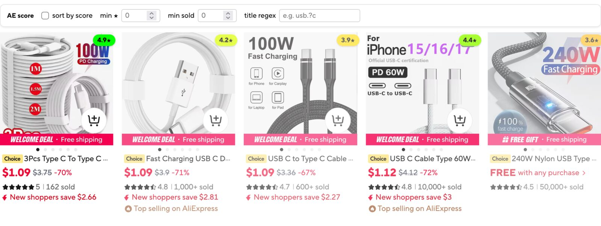

# AliExpress Review Score Color Borders

Scores AliExpress search results by star rating and order volume together, and adds a small filter bar above the results.

## What it does

- adds a score pill (stars) in the corner of each result card, colored from weak to strong
- fades lower-scoring cards so the best listings stand out
- hover a card to see its details: stars, sold or order count, and the score breakdown
- adds an "AE score" bar above the results with:
  - sort by score, which reorders cards by score and can be switched off to restore the original order
  - min stars and min sold, which hide cards below the thresholds
  - title regex, which hides non-matching cards and highlights matches in titles; invalid patterns show a red border
- rescores the visible set whenever filters change, so ranking matches what you see
- settings persist in localStorage under `ae-score-settings-v2`
- works on aliexpress.com and aliexpress.us search pages

## Limitations

- the "sold" figure is the compact count AliExpress shows (for example "1,000+ sold"), so it is a lower bound unless the card link carries an exact order count
- relies on AliExpress search page markup, which changes from time to time
