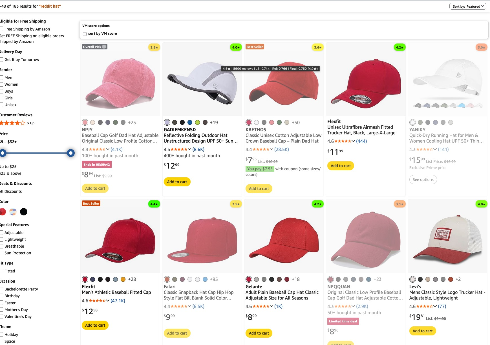

# Amazon Review Score Color Borders

Scores Amazon search results by how well-supported each rating is, so a few glowing reviews never outrank a product with thousands of solid ones.

## What it does

- scores each item with a 95% lower bound on its star rating given its rating count, so items with few ratings score low until they have enough to back up their stars
- shows that conservative rating as a colored pill in 1-5 stars on each item, for example 4.6 stars from 137K ratings stays 4.6 while 5.0 from 3 ratings shows 3.1
- colors pills and fades items by rank among the items scored in the same pass; an item returns to full opacity on hover
- shows a tooltip with stars, rating count, the lower bound, page rank, and price against the page median
- adds a "VM score options" box above results with a "sort by" dropdown:
  - Rating + price (default): the lower bound, shifted 0.15 stars per halving or doubling of price against the page median, capped at 0.5 stars so price never outweighs quality
  - Rating only: the lower bound alone
  - Rating + price rank: 70% rating, 30% cheapness rank on the page; leans harder on price, so a cheap weaker item can climb
  - Cheapest rated 4.3+: items with a lower bound of 4.3 stars or better, cheapest first, then the rest by rating
  - Amazon order: no sorting
- in price modes the pill also shows price against the page median, for example `4.7★ · 0.5x`
- compares unit prices such as "$1.70/100 Sheets" among items sharing that unit when at least 3 do, and item prices otherwise; a unit price that disagrees with the item price by more than 50x is treated as a listing error
- recomputes price comparisons over every scored item on each pass, so items loaded later sort consistently with earlier ones
- uses Amazon's original order as the tiebreaker
- saves the sort choice in localStorage under `vm-score-settings-v1`
- works on search results and bestseller-style listing pages, including results added later on the page

## Limitations

- Amazon shows ratings rounded to 0.1 stars and weights them its own way, so items with many ratings that differ by 0.1 stars are close calls
- review authenticity is not checked; the bound only guards against too few ratings
- items without a featured price, such as "See options" listings, get no price adjustment
- bestseller pages show no unit prices, so they compare item prices across the whole list

## Demo

