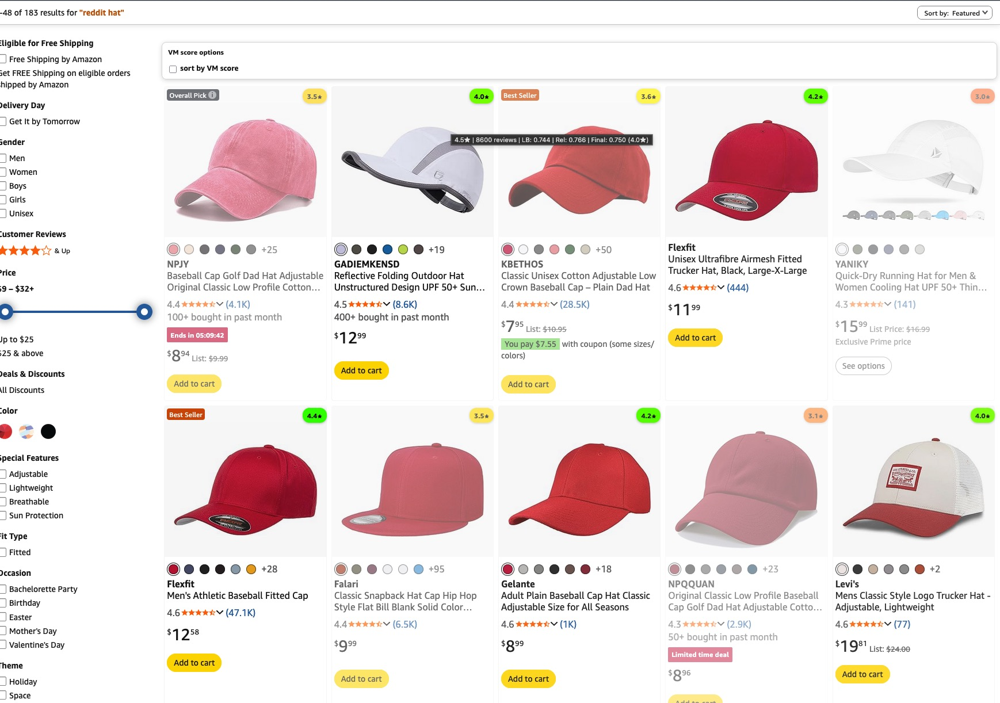

# Amazon Review Score Color Borders

This userscript makes Amazon result pages easier to scan by scoring listings with review-aware colors instead of relying on star rating alone.

## What it does

- scores each item using review count and star rating together, with a Wilson lower bound
- blends that score with a rank among the items on the page into a final score
- shows a colored score pill with the final score in 1-5 stars on each item
- fades lower-scoring items; an item returns to full opacity on hover
- shows a tooltip with stars, review count, lower bound, relative rank, and final score
- adds a "VM score options" box above results with a "sort by VM score" toggle
- keeps Amazon's original order when sorting is off, and uses it as the tiebreaker when on
- saves the sort toggle in localStorage under `vm-score-settings-v1`
- works on search results and bestseller-style listing pages, including results added later on the page
- ranks only the items scored in the same pass, so scores on later-loaded results are not comparable to earlier ones

## Demo

