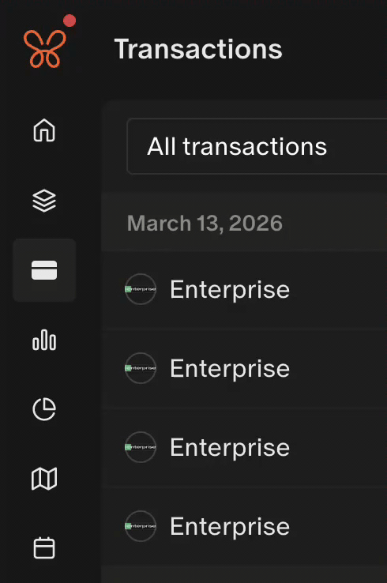

# Monarch Money

Userscripts that add multi-select and CSV export to Monarch Money pages.

## Monarch Bulk Select

Adds shift-click range selection and CSV export to the transactions list.

- Shift-click a transaction checkbox to select or clear everything between it and the previous click.
  The range takes the state of the box you shift-click.
- While transactions are selected, a **Download CSV** button appears in the bulk-action header.
- The export scrolls the virtualized list to collect every selected row, then restores your scroll position.
- CSV columns: date, merchant, category, account, amount, and list_index (the row position in the list).
- File name: `monarch-selected-transactions-YYYY-MM-DD.csv`.
- If fewer rows are found than the selected count, an alert reports how many were exported.

[Youtube Link](https://www.youtube.com/shorts/zCZKhdNT33o)

## Monarch Holdings Export

Adds an **Export CSV** button next to Accounts on the investment holdings page (`/investments/holdings`).

- One row per holding, with a Group column taken from the section headers on the table.
- Columns are Group, Symbol, and Name, followed by the table's value columns under Monarch's own headers.
- Currency amounts are written as plain numbers (no `$` or thousands separators). Other text is kept as shown.
- Holdings without a ticker put the name in Name and leave Symbol blank.
- File name: `monarch-holdings-YYYY-MM-DD.csv`, UTF-8 with a BOM so Excel opens it cleanly.
- If the table has no rows yet, an alert asks you to wait for it to load.
