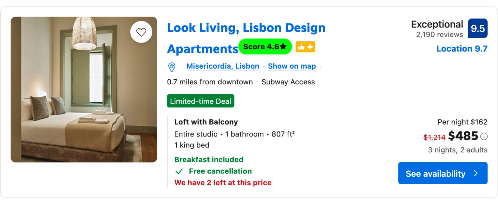
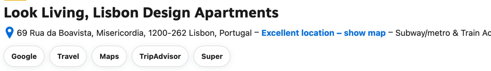

# Booking.com Userscripts

Two userscripts that make Booking.com search results and hotel pages easier to compare.

## Booking Listing Score

Adds a review-aware score pill to each result on Booking.com search pages.

- combines the guest rating and the number of reviews into one score, so a 9.0 from 12 reviews does not outrank a 9.0 from 2,000
- colors each pill relative to the other results on the page (red to yellow to green)
- shows the score as stars next to the property title; hover for the rating, review count, and score breakdown
- also marks map pins with a score pill, matched to the pin by total stay price
- re-scores as you scroll, filter, or load more results

Runs on `booking.com/searchresults.html`.

## Booking Hotel Links

Adds a row of search links under the property header on Booking.com hotel pages, so you can cross-check the same property elsewhere.

- links to Google, Google Travel, Google Maps, TripAdvisor, and Super.com
- builds the query from the property name, address, and city
- carries over your check-in and check-out dates and guest count where the target site supports them

Runs on `booking.com/hotel/*`.

## Limitations

- scores are relative to the results currently loaded on the page
- map pin scores are matched by price, so pins sharing a price show an averaged score
- price parsing expects dollar amounts
