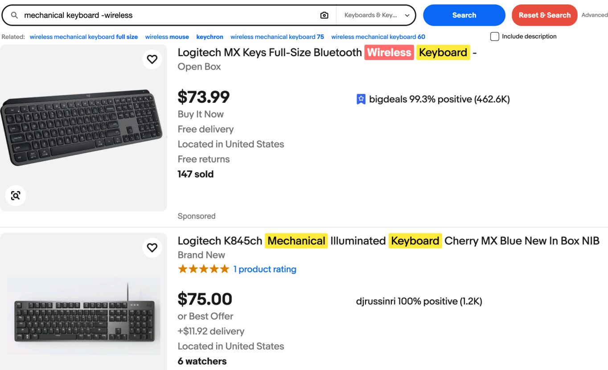
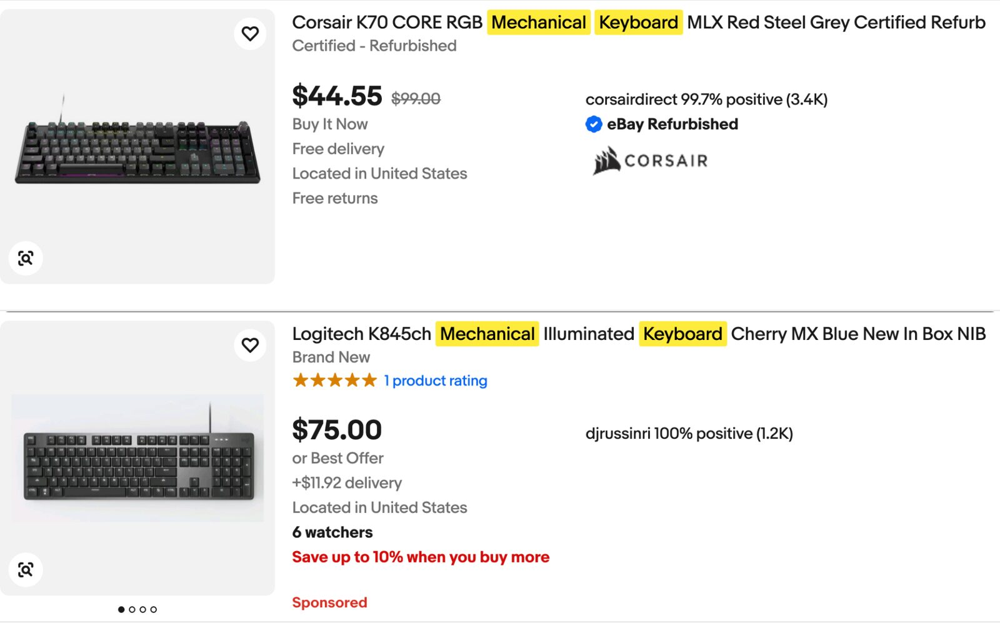

# eBay Userscripts

Small scripts for eBay: search results that are easier to scan, and a shipping label helper for sellers.

## eBay Search Enhancer

Keeps your filters when you refine a search and highlights your search terms in listing titles.

- keeps active filters when you submit a new query from the search bar on a results page
- adds a red "Reset & Search" button next to the Search button to run the query with all filters cleared
- highlights search words in listing titles in yellow
- highlights excluded words (`-word`) in red when they still appear in a title
- keeps highlighting new results as more load
- runs on ebay.com, ebay.com.au, ebay.co.uk, and ebay.ca

## eBay Sponsored Listings Highlighter

Recolors eBay's own "Sponsored" label on result cards to bold red so ads are easy to spot.

- styles the native label only, no listings are hidden or changed
- eBay hides the real label among decoy images on every card, so the script checks which ones actually paint a label
- runs on ebay.com

## eBay Label Max Package

On the eBay single-label page, finds the largest weight and dimensions that keep the price of the shipping service you selected.

- select a shipping service, then click "Find max at same price" under the package form
- raises the weight first, then grows length, width, and height together, and shows a before/after table
- stays within the service's own weight and size limits, and the price must match the current price exactly
- a search sends a few dozen quote requests in parallel batches of 4 to eBay's own label quote endpoint (the result shows the exact count); each reuses the page's own request with only the package size swapped
- nothing changes on the page until you click "Apply max", which fills the weight and size fields and submits the package form so eBay saves it and requotes
- never buys or prints a label
- runs on ebay.com/ship/single pages

## Limitations

- the Sponsored Highlighter depends on eBay's current label markup and may need an update if eBay changes how it draws the label
- result highlighting reads the `_nkw` search parameter, so it applies to search result pages only
- the Label Max Package search needs the page to have loaded a quote first, so reload the page if it reports that no quote was captured
- the Label Max Package search assumes price never drops as the package grows, so an unusual rate table can give a smaller result than the true maximum
