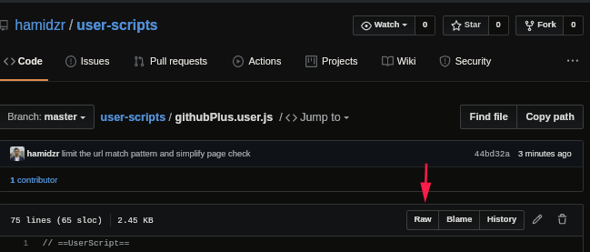
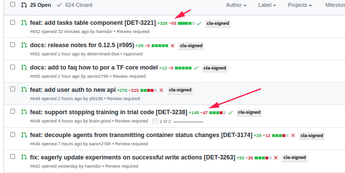

# GitHub Userscripts

Two userscripts for GitHub pull requests. One sorts status checks so failures come first, the other shows additions and deletions next to each pull request in lists.

## GitHub Status Checks

Reorders pull request status checks so failures and in-progress items appear first.

- order: failed, in progress, unknown, pending, skipped, completed, then passed
- runs on pull request pages and waits for more than five checks to load before the first reorder
- re-checks the order every 3 seconds, so checks that change state move into place

## GitHub PullRequests Plus

Adds per-pull-request additions and deletions next to links in pull request lists.

- shows `+additions -deletions` after each pull request link in the list view
- makes one request per listed pull request to its files page, once per page load
- runs on repository pull request lists and pull request pages

