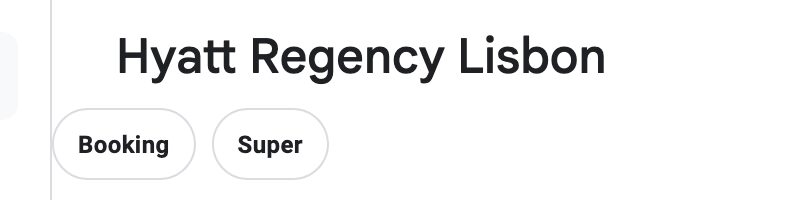

# Google Userscripts

Shortcuts for Google Travel, Flights, Maps and Search: booking links on hotel pages, destination weather, saving places to a Roamline trip, and lucky redirects.

## Google Travel Links

Adds quick search links to the header of a hotel page on `google.com/travel/*`.

- adds Booking and Super buttons right under the hotel name
- builds each link from the hotel name, address, city, and country on the page
- carries over check-in and check-out dates and the adult count when Google Travel shows them
- updates when you move between hotels without a page reload
- shows nothing if the hotel name or location cannot be read

## Google Flights Roamline Climate

Shows the usual weather for your travel month on Google Flights Explore, from [Roamline](https://roamline.lbyte.app)'s monthly climate averages.

- adds a line under each destination card: temperature range, rainy days, and sunshine for the month the trip starts
- adds a short version to the price labels on the map
- links each card to the city's Roamline page
- shows Fahrenheit for US English browsers and Celsius everywhere else
- needs no account; it reads Roamline's public climate data and caches it for a day

## Add to Roamline

Adds an "Add to Roamline" button to Google Maps place pages, so a place you find on the map goes straight into a [Roamline](https://roamline.lbyte.app) trip.

- sends the open place to a trip's pool of ideas, or to the end of one of its routes
- remembers the last trip and route you picked
- keeps only the place's name, its category, its point, and Google's place id
- signs in with a Roamline token you create under Agent access, kept in your userscript manager's storage
- is built and served by Roamline itself, so it updates with each Roamline release

## Google Feeling Lucky Redirect

Skips the results page for "Feeling Lucky" style searches.

- on `google.com/search?q=...`, if the URL mentions "feeling lucky" (for example from the I'm Feeling Lucky button), opens the first result automatically
- on `google.com/url?q=...` redirect pages, jumps straight to the target URL

## Limitations

- Google Travel Links only works on individual hotel pages, not on search result lists
- the Roamline scripts need roamline.lbyte.app to be reachable, and Add to Roamline needs a free Roamline account
- all of them depend on Google's page markup, which can change
