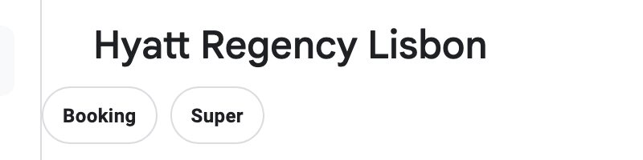

# Google Userscripts

Two userscripts for Google: Booking and Super links on Google Travel hotel pages, and a redirect that skips the results page for "Feeling Lucky" searches.

## Google Travel Links

Adds quick search links to the header of a hotel page on `google.com/travel/*`.

- adds Booking and Super buttons right under the hotel name
- builds each link from the hotel name, address, city, and country on the page
- carries over check-in and check-out dates and the adult count when Google Travel shows them
- updates when you move between hotels without a page reload
- shows nothing if the hotel name or location cannot be read

## Google Feeling Lucky Redirect

Skips the results page for "Feeling Lucky" style searches.

- on `google.com/search?q=...`, if the URL mentions "feeling lucky" (for example from the I'm Feeling Lucky button), opens the first result automatically
- on `google.com/url?q=...` redirect pages, jumps straight to the target URL

## Limitations

- Google Travel Links only works on individual hotel pages, not on search result lists
- both scripts depend on Google's page markup, which can change
