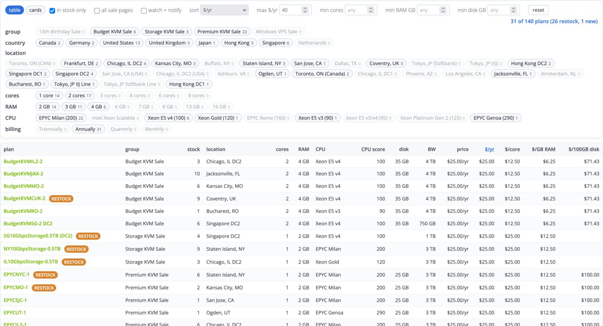

# GreenCloudVPS Plan Filter

Filters, sorts, and tabulates the plans on GreenCloudVPS store pages, and flags plans that are new or back in stock.

## What it does

- replaces the card grid with a sortable table by default; a "cards" button switches back to the original cards
- lists stock, location, cores, RAM, CPU, CPU score, disk, bandwidth, price, and billing cycle for each plan
- annualizes every price and shows $/yr, $/core, $/GB RAM, and $/100GB disk per plan
- identifies the CPU family and shows a rough CPU score next to it; hover the CPU cell for the basis
- filters with chips for group, country, location, cores, RAM, CPU, and billing cycle, each with a live count
- filters with an "in stock only" toggle and number boxes for max $/yr, min cores, min RAM GB, and min disk GB
- sorts by page order, $/yr, $/core/yr, $/GB RAM/yr, $/100GB disk/yr, most stock, or CPU score; click a sortable column header to sort, and click it again to return to page order
- dims out-of-stock plans
- badges plans as "new" or "restock" for 12 hours after the script first sees them or sees them come back in stock, and shows the badge counts in the plan counter
- "all sale pages" fetches the other sale pages (the pages in the store nav with "sale" in the URL) and lists all their plans in one table; the page reloads when you change it
- "watch + notify" reloads the page about every minute (60s plus up to 15s of random jitter) and, if notification permission is granted, sends a desktop notification for new or restocked in-stock plans that match your filters; the tab title shows the number of fresh plans
- turn watch mode off by unchecking "watch + notify" (the page reloads once); closing the tab also ends it
- saves your filters in localStorage under `gcvf-filter-state`
- tracks what it has seen per sale page in localStorage under `gcvf-seen:<page path>`
- remembers watch mode in sessionStorage under `gcvf-watch`, so it stays with the tab that turned it on
- runs on `https://greencloudvps.com/billing/store/*` pages

## Limitations

- parses GreenCloudVPS store page markup, which can change; plans with missing fields show blank cells
- "all sale pages" loads each sale page with an extra request, so it adds a few requests per page load (and per watch reload); a page that fails to load is skipped
- annual prices are computed from the listed price and billing cycle, so they assume the plan is renewed at that rate
- CPU scores are approximate and cover only the CPU families the script recognizes
- watch mode reloads the whole page, so it only runs while the tab stays open
