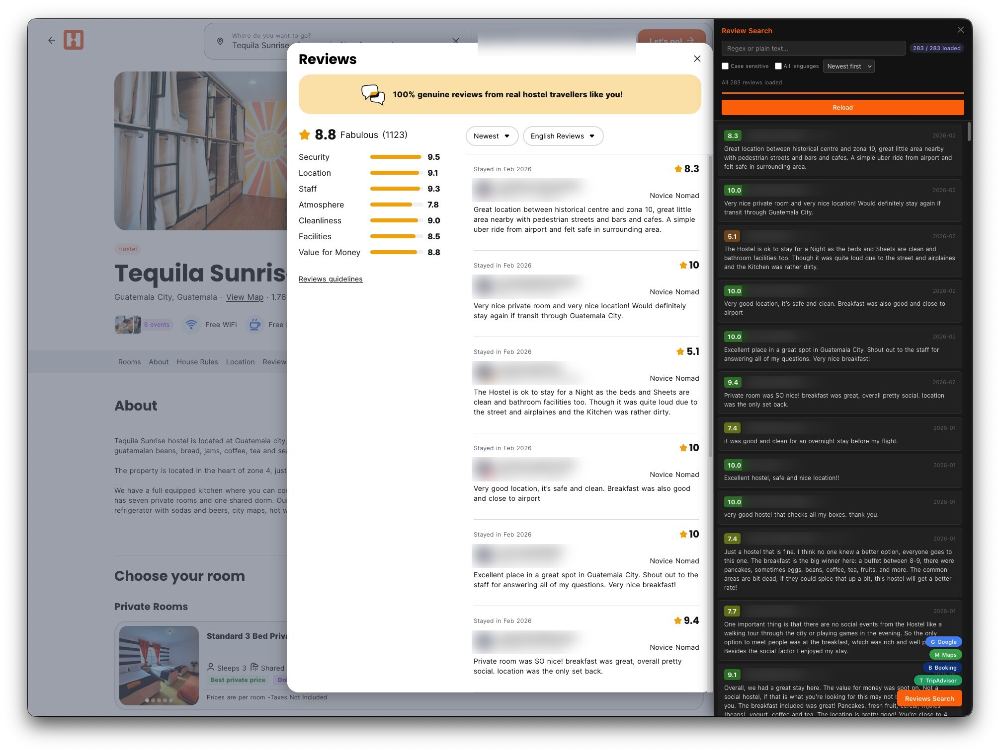

# Hostelworld Enhancer

This userscript adds a review search panel to Hostelworld property pages so review text is easier to search and compare.

## What it does

- adds a **Reviews Search** button on property pages that opens a panel of reviews
- loads all reviews with **Load all reviews**, fetching four pages at a time with a progress bar
- filters reviews live by regex or plain text, matched against review text, with matches highlighted
- shows an error style on the search box when the regex is invalid
- **Case sensitive** toggle for the filter
- **All languages** toggle reloads reviews written in every language
- sorts by newest first or by score
- opens the panel and loads reviews automatically when the URL includes `display=reviews`
- adds quick search links for Google, Travel, Maps, Booking, Super, and TripAdvisor
- passes `from`, `to`, and `guests` URL parameters from the page into the quick search links

## Demo

