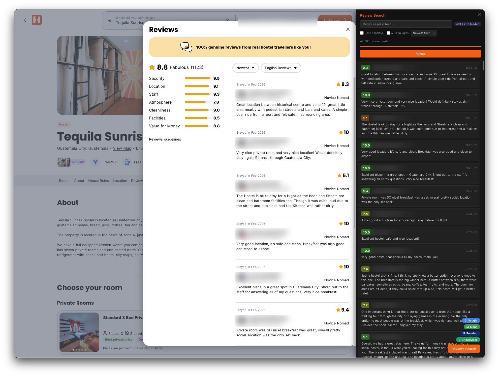

# Hostelworld Enhancer

Ranks Hostelworld results by rating and review count, and adds a review search panel to property pages so review text is easier to search and compare.

## What it does

- adds a score pill next to each rating on search and city pages that combines the rating with the number of reviews, so a 9.9 from 141 reviews does not outrank a 9.7 from 15,000
- shows the score on Hostelworld's own 1-10 scale (a 95% lower bound on the rating given its review count) and colors it relative to the other results on the page; hover for the rating, review count, and page rank
- adds a **Sort by** control at the bottom left of search and city pages: Site order (default), Score, or Score + price, which nudges the score by the cheapest bed or room price against the page median, capped so price never outweighs quality
- adds a **Reviews Search** button on property pages that opens a panel of reviews
- loads all reviews with **Load all reviews**, fetching four pages at a time with a progress bar
- filters reviews live by regex or plain text, matched against review text, with matches highlighted
- shows an error style on the search box when the regex is invalid
- **Case sensitive** toggle for the filter
- **All languages** toggle reloads reviews written in every language
- sorts by newest first or by score
- opens the panel and loads reviews automatically when the URL includes `display=reviews`
- adds quick search links for Google, Travel, Maps, Booking, Super, and TripAdvisor
- passes `from`, `to`, and `guests` URL parameters from the page into the quick search links

## Limitations

- scores are relative to the results currently loaded on the page
- Score + price compares the cheapest listed price, so a hostel with cheap dorms ranks as cheap even if you want a private room

## Storage

- `lb-sort-hostelworld` (localStorage): the chosen sort

## Demo

