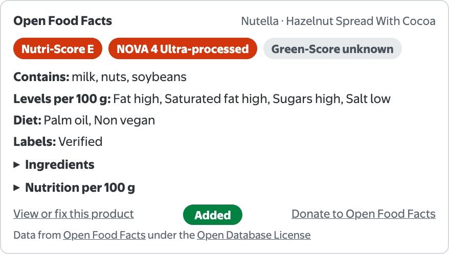
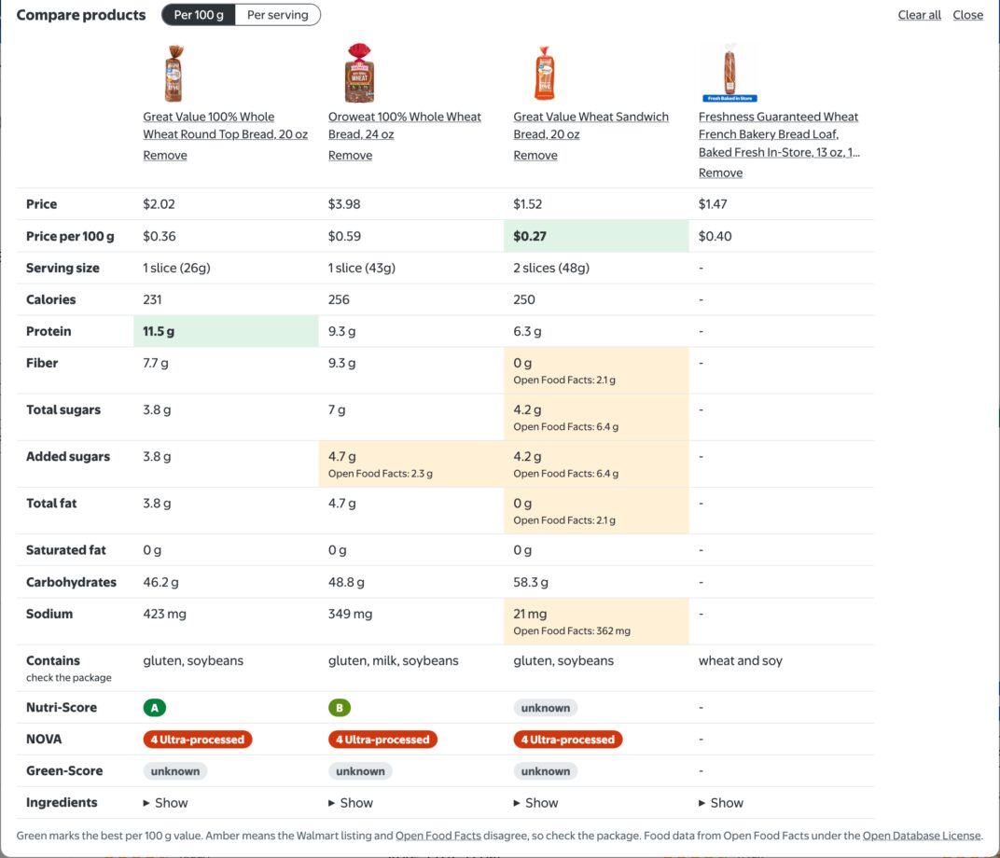

# Grocery Food Facts

Shows Open Food Facts scores, allergens, additives, and nutrition right on Walmart and H-E-B product pages, and compares Walmart products side by side per 100 g, so you can pick the better food even when serving sizes differ.

## What it does

- adds an Open Food Facts panel to product pages, under the title on Walmart and under the price on H-E-B
- shows Nutri-Score, NOVA, and Green-Score as color-coded pills
- lists allergens, possible traces, additives, nutrient levels, diet flags, and labels
- expands to the full ingredients and a nutrition table per 100 g
- keeps up as you move between products without a full page load
- links to the product on Open Food Facts so you can view or fix it, and to their donation page
- shows the ingredients and allergen text from the Walmart listing when Open Food Facts has no entry, or fills them in when its entry has none
- warns when a Walmart listing contradicts its own ingredients, for example saying "No high-fructose corn syrup" while listing it
- offers an add-product link when a barcode has no entry yet
- offers a search by name when a listing has no global barcode, which is common for produce, deli, and meat
- sends only the barcode of the product you are viewing to Open Food Facts

## Compare products

- adds a Compare button to Walmart product cards on hover, and to the panel on product pages
- keeps your picks in a Compare tray as you browse, across tabs, up to 6 products
- lines them up with price, price per 100 g, serving size, nutrition, allergens, scores, and ingredients
- switches between per 100 g, which makes different serving sizes fair, and the printed per-serving values
- marks the best per 100 g value in green for price, protein, fiber, sugars, saturated fat, and sodium
- uses the Walmart listing first and fills gaps from Open Food Facts
- shows both numbers in amber when the two sources disagree, and names no winner on that row
- makes one Walmart page request and one Open Food Facts lookup per product you add, and nothing until you click

## Limitations

- the data is crowd-sourced and can be missing, out of date, or wrong, so check the package itself, especially for allergens
- nutrition is per 100 g, not per serving
- runs on www.walmart.com and www.heb.com only, and comparing, listing ingredients, and the claim check work on Walmart only
- the claim check covers plain "no x" and "x-free" wording for corn syrup, palm oil, artificial flavors, colors, and sweeteners, hydrogenated oils, and MSG, so no warning does not prove a claim is true
- listings with no nutrition data, common for store bakery items, only show price, allergens, and ingredients in the comparison
- prices in the comparison are from when you added the product
- drinks are compared per 100 ml under the same per 100 g labels
- needs a userscript manager with `GM_xmlhttpRequest`, and it may ask you to allow connections to world.openfoodfacts.org
- Open Food Facts limits lookups to 15 a minute per IP address, so very fast browsing may show a lookup error

## Storage

- `vm-off-compare-v1` in localStorage holds your comparison list

## Data

Contains data from [Open Food Facts](https://world.openfoodfacts.org), available under the [Open Database License](https://opendatacommons.org/licenses/odbl/1-0/).
