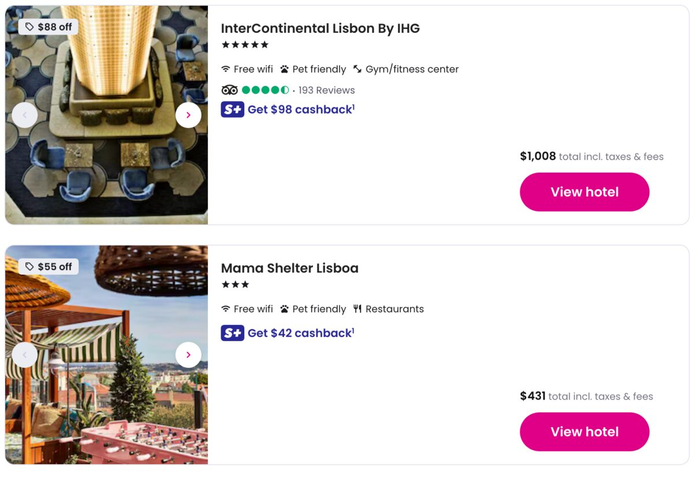
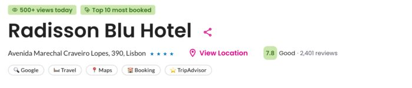

# Super.com Enhancer

Makes Super.com hotel search easier to read by showing total prices instead of nightly rates.

## What it does

- replaces the nightly price on map pins with the total stay price
- bolds the total price on list cards and dims the nightly rate
- bolds the total price on hotel detail rate cards and hides the "total savings" row
- collapses the strikethrough and nightly lines on detail price cards until you hover
- adds Google, Travel, Maps, Booking, and TripAdvisor search buttons on hotel detail pages, using your dates and guest count

Runs on `super.com/home/travel*` and `super.com/travel/*`.

## Limitations

- map pin totals depend on the map view data Super.com loads, and are matched to pins by nightly price
- the detail page search buttons appear under the address row (the one with the "View Location" control) and need that control to be on screen
